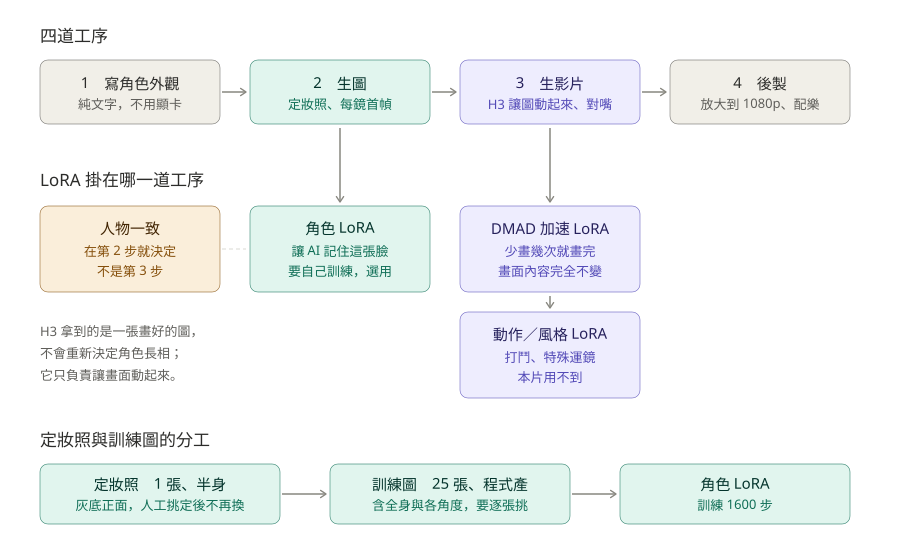

# 08 四道工序與 LoRA 的角色定位

> 📌 本文整理自屏北高中「影音生成」專案製作《團結》（2026-10-19～23）的實驗紀錄，數據與出處照原樣保留。文中「本片」指《團結》或 SEL 第 1 集；角色名（大頭、阿凱、阿文老師、老蔡）是那兩部片的角色。原紀錄提到的比較圖、影片在影音生成專案的 `製作/短片_團結/v2試拍/`，沒有收進本 repo。

> 用途：搞清楚「每一道工序在做什麼」「哪種 LoRA 掛在哪裡」「什麼需要顯卡、什麼不用」。
> 建立日期：2026-10-16　｜　依據：三師爸原版（本 repo）的 `docs/01`、`docs/02`、`docs/03`、`docs/07`、`setup/lora/README.md`

## 一句話版本

**Qwen 生圖做臉與首幀 → H3 把首幀變成會說話的影片 → FlashVSR 放大、Music 3 配樂。**

角色長什麼樣，在**第 2 步就定案**了；第 3 步的 H3 拿到的是一張畫好的圖，它只負責讓畫面動起來、嘴型對上台詞，**不會重新決定角色長相**。

## 四道工序

| 工序 | 在做什麼 | 用什麼 | 要顯卡嗎 |
|---|---|---|---|
| 1　寫角色外觀 | 用英文把年齡、臉型、髮型、眼鏡、上衣**與下半身**寫清楚 | 人腦 | ❌ |
| 2　生圖 | 先生 1 張定妝照，再依定妝照生每一鏡的首幀（1344×768） | Qwen-Image 2.1、Qwen-Image-Edit 2511 | ✅ |
| 3　生影片 | 吃「首幀＋台詞音訊」，產出會動、嘴型對得上的影片 | MiniMax H3 Ref2VA | ✅ |
| 4　後製 | 768p 放大到 1080p、配樂、剪接 | RTX VSR／FlashVSR、MiniMax Music 3 | ✅ |

第 2 步的首幀要**人工審過**（建立 `frames_ok` 空檔），第 3 步的 H3 才會開跑。

## LoRA 的三種定位

LoRA 是掛在模型上的小外掛。關鍵是**它改變生成任務的哪個環節**：

| LoRA | 它決定什麼 | 掛在第幾步 | 本片要不要 |
|---|---|---|---|
| **角色 LoRA** | 演員是誰——讓 AI 記住大頭這張臉 | 2 | 選用，六集會划算 |
| **動作／風格 LoRA** | 演員做什麼、畫面什麼質感 | 3 | △ 已下載 2 顆實測，見下方「實測」 |
| **加速 LoRA（DMAD）** | **要花多久畫完**，但步數太少會壓不住首幀（換臉） | 3 | ✅ 預設 8 步／強度 0.8 |

### DMAD 到底在做什麼

AI 畫影片的方式，是**從一片雪花噪訊開始，一次一次把它擦乾淨**。原本要擦 14 次才夠清楚，DMAD 教會它 **4 次就擦到一樣清楚**。

- 效果只有一個字：**快**。repo 實測快 49–58%（107 格的鏡頭 67 秒）
- 畫質：8 類鏡頭並排**看不出差**
- 原版地位：`spec` 加 `"draft": true` ＝ DMAD 4 步，日常定稿的預設
- **本 repo 已改成 8 步、強度 0.8**（film.json `h3.dmad`）：2026-10-23 實驗證實 4 步壓不住參考圖，動作大的鏡頭會換臉；8 步效果等同不加速 20 步、時間約一半（見 `10_影片品質實驗.md`）。所以 DMAD「跟畫面內容無關」只在動作小的鏡頭成立
- 規則：抽到就用，**不要同 seed 改 14 步重生**
- 原版的例外（退回 14 步）：骨架舞蹈、群舞、細膩含淚表情、Combat LoRA 拉滿的打鬥

把它想成拍電影：角色／動作／風格 LoRA 是在選**演員、動作、攝影風格**；DMAD 是換一台**跑得比較快的機器**——換了機器，演員和劇本都不會變。

### 常見誤解

> ❌「DMAD 是讓人物保持一致的吧？」

不是。人物一致靠的是第 2 步的兩招之一：

1. **定妝照當參考圖**（Qwen-Image-Edit，預設做法）← 第 1 集現在用這個
2. **訓練角色 LoRA**（更像、2K 畫質，但每角要花 1～1.5 小時）

## 定妝照 vs 訓練圖：不要搞混

| | 定妝照 | 訓練圖 |
|---|---|---|
| 幾張 | **1 張** | **25 張** |
| 景別 | **半身**（medium close-up bust portrait） | 含全身、各種角度／表情／場景 |
| 誰做的 | 你下提示詞生，多生幾張挑一張 | `make_lora_dataset.py` **從定妝照自動產**，約 18.6 分鐘 |
| 要人工做什麼 | 挑一張定案，**之後不要再換** | **逐張看**，刪掉臉不像、多手多腳、有字、穿錯衣服的 |
| 用途 | 當參考圖生首幀；也是訓練圖的種子 | 只拿來訓練角色 LoRA |

**定妝照只要半身**（repo `docs/07` §1：灰底、正面、半身、只有一個人）。而且**只能一格**——試過把「全身＋半身＋臉」三格拼成一張當參考，Qwen 會把版面也照抄，生出拼貼圖。

但外觀描述**一定要連下半身寫**（例 `navy pleated skirt`）。因為訓練圖會自動產生全身鏡，沒寫下半身，Qwen 會隨機配裙子／長褲／短褲，LoRA 就學到不一致的下半身。（但這段文字**不要**放進 film.json 的 `look`，要放 `look_full`，見 `09_失敗紀錄.md`。）

**所以：多張照片只有訓練角色 LoRA 時才需要，而且是程式自動產的，不用你一張一張生。**

## 角色 LoRA 要不要做

repo 明說「不訓練也能做片」。兩條路 2026-10-07 實測都**像本人**：

| | A. Qwen-Image-Edit 附參考圖 | B. 訓練角色 LoRA |
|---|---|---|
| 前置成本 | **零** | 每角：產圖約 20 分＋訓練 1～1.5 小時（真實 16GB 卡推估） |
| 長相 | 像 | 最像 |
| 輸出 | 直接 1344×768（H3 要的尺寸） | 2K，細節最好，縮小再給 H3 |
| 多人同框 | 最多 3 張參考圖，2 人實測可行 | **兩個 LoRA 同掛會互相稀釋**，要逐人重繪 |

第 1 集的 `film.json` 走的是 **A**（`gen_image.py --model qwen-edit`），不訓練也能跑完。六集要拍、五個角色反覆出現，訓練 LoRA 才划算——但那是五次訓練，約 5～7.5 小時。

**不要用的做法**：Qwen-Image 2.1 直接附參考圖（不訓練）。長相會像，但每張都變成正面置中姿勢，要求「側臉看窗外」也沒用。

### 訓練 LoRA 的順序

0. 裝 AI Toolkit（**第五個環境**，`C:\AI\lora\ai-toolkit`，commit `60d0c28`）— LIB-office 已於 2026-10-16 安裝
   - 訓練設定範本：`setup/lora/qwen21_character_lora_template.yaml`
   - 要替換的欄位：`__NAME__`、`__OUTPUT_DIR__`、`__DATASET_DIR__`、`__TRIGGER__`、`__DESC__`
   - 第一次訓練會從 Hugging Face 下載 `Comfy-Org/Qwen-Image-2.1` 當底模，要等
1. 生定妝照（`gen_image.py`，1024×1024）
2. 產訓練圖（`make_lora_dataset.py`）
3. **逐張人工挑**，刪掉壞的
4. 訓練（768 解析度、rank／alpha 32、lr 1e-4、1600 步；**ComfyUI 要先關掉**）
5. `.safetensors` 丟進 `models\loras\`，`gen_image.py --lora <名>:1.0`，提示詞要**同時有觸發詞＋外觀描述**

⚠️ 硬體警告：16GB 顯卡＋32GB 記憶體訓練 1600 步，實測顯存峰值 14.7GB、**系統記憶體最低只剩 0.5GB**。原文寫「能跑完但非常極限：32GB 電腦訓練時務必關掉所有其他程式」。LIB-office 正是這個配置。

## 其他 LoRA 的取用原則

原版內建的動作 LoRA（Combat_V2、GunFu、Motion_Repair、speed_slider）預設不必下載，因為是打鬥／特效用（《團結》後來下載 Combat、Motion_Repair 實測，見下方）。其中 `Motion_Repair` 雖名為通用動作修復，但 `docs/03` 警告：**要保住首幀時避開 Motion_Repair 高強度**——本片的命脈就是角色長相一致，所以不用。

外部生態（HuggingFace 掛在 H3 底下約 151 個 adapter）要過三層篩子：

1. **底模**＝MiniMax H3
2. **任務模式**＝`ref2va`（我們用的）。多數熱門 LoRA 是 `i2v`／`t2v`，**底模對了模式沒對一樣不能用**
3. **授權**。JOKER141、RunningHubAI 那幾顆**未標示授權＝保留所有權利**；也有排除美／歐／英／韓的

原則：先用提示詞解決，再考慮 LoRA；一顆只解一個已經撞到的問題；同時最多兩顆；下載鎖 commit；本機 A/B 比過才留。

## 實測：動作 LoRA 對照（2026-10-22，《團結》N1 走廊擦撞）

已下載 `Motion_Repair_V2`、`H3_Combat_V2`（各 155 MB，鎖 commit、sha256 驗過）到 ComfyUI `models\loras\`。
同一張首幀、同一個 seed、同一份提示詞，只換 LoRA（當時腳本 `lora_ab.py`，本 repo 併入 `tools/h3_ab.py`）：

| 組 | LoRA | 結果 |
|---|---|---|
| A | 不掛 | 阿凱轉身與大頭並肩走向鏡頭、作業簿淡出 |
| B | Motion_Repair 0.5 | 與 A 幾乎相同 |
| C | Motion_Repair 0.9 | 與 A 相同；作業簿掉落稍微看得到 |
| D | Combat 0.7 | 與 A 相同；作業簿掉落稍微看得到 |
| E | Combat 0.7＋MR 0.5 | 與 D 相同 |

**結論**：五組的走位、構圖、臉幾乎一模一樣——**LoRA 在這個強度下不改變「演什麼」**，H3 誤解劇情（讓兩人並肩走）的問題出在首幀＋提示詞，不是動作連貫性。好消息是臉也沒跑掉、沒有 3D 遊戲感。
**用法**：要疊 DMAD 時，spec 設 `draft: false`、`lora: [DMAD 1.0, 動作 LoRA]`、`steps: 4`、`sampler: euler`、`shift: {video: 12, audio: 2}`（`draft: true` 會把自訂 LoRA 蓋掉）。
**下一步可試**：Combat 適合「動作本身已經演對、只是不夠有力」的鏡頭（例如學生推擠、拍桌），不適合救走位錯的鏡頭。

### 實驗二：學生推擠鏡 X1（2026-10-22，不進成片）

動作改成「阿凱雙手推大頭胸口一次 → 大頭踉蹌、作業簿飛散」，約束寫「只推一次、不揮拳、不揪衣服、不倒地」。同首幀、同 seed（`tools/h3_ab.py CB07,CB10 <鏡>` 可重做）：

| 組 | LoRA | 結果 |
|---|---|---|
| A | 不掛 | 有推、作業簿散落；力道普通，作業簿飛出時糊成白色色塊 |
| B | Combat 0.7 | 推得較用力、站姿壓低；第 2 下變成直臂衝出去，接近出拳 |
| C | Combat 1.0 | 升級成扭打（揪住對方），**違反「不揪衣服」約束**；遠處多出路人 |
| D | Combat 0.7＋MR 0.5 | 與 C 類似的扭打，大頭被推到彎腰 |

**結論**：
- 動作本身演對時，**Combat 確實有效果**：力道、身體重心、衝擊感都比不掛強，且臉沒跑掉、沒有 3D 感。
- **強度越高越「好戰」**：0.7 已會多推一下，1.0 會把推擠升級成扭打，**連提示詞的約束都壓不住**。要控制衝突程度，用 0.5～0.7。
- 四組共同問題：撞擊那一瞬間手上的作業簿糊成花紋（物品在快速動作中崩壞），LoRA 修不好。
- 適用：學生推擠、拍桌、對峙這類「要有力道」的鏡頭；**老師在場的鏡頭一律不掛**（避免把老師也捲入動作）。

### 實驗三：同一畫面兩顆角色 LoRA（2026-10-23）

問題：兩人同框時直接掛角色 LoRA，LoRA 會套到每個人身上（《團結》N1 阿凱也長成大頭）。本 repo 的工具：`tools/regional_inpaint.py`（hook 區域 LoRA 那支 `regional_lora.py` 跑不起來，沒有收）。

| 組 | 做法 | 結果 |
|---|---|---|
| A | 不掛 LoRA，只靠文字 | 兩人不同，但右邊不像大頭本人 |
| B | 大頭 LoRA 掛整張 | **外溢**：左邊的人也被拉向大頭的臉型與髮型 |
| C、D | ComfyUI 內建 hook 區域 LoRA（每段提示詞綁一顆 LoRA＋遮罩） | **跑不起來**：`'Linear' object has no attribute 'weight_scale'`——hook 不支援我們的 int8 壓縮版 Qwen-Image；未壓縮版約 40 GB，這台機器放不下 |
| E | **分區重繪**：A 當底圖 → 遮右半、掛大頭 LoRA、重畫強度 0.75 | ✅ 右邊變成大頭，左邊完全沒變 |
| F | E 再遮左半、掛老蔡 LoRA 重畫 | ✅ **同畫面兩顆 LoRA 成功**：左老蔡（眼鏡、白襯衫）、右大頭，接縫看不出來 |

**結論**：
- 這台機器上「同畫面多角色 LoRA」的可行做法是**分區重繪**（一次只掛一顆，用遮罩只重畫那個人的區域，邊緣羽化 80px＋DifferentialDiffusion），每多一個角色多一次重繪（約 1 分鐘）。
- 前提是**兩人在畫面上分得開**（各占一邊）。兩人重疊、交錯（例如撞肩那一瞬間）就不能用左右切，要改用人形遮罩。
- 重畫強度 0.75：太低換不了臉，太高會跟另一半接不起來、背景也會跑。
- 首幀做好後，H3 本身不認識 LoRA，影片中段仍可能臉部漂移（N1 約 3 秒後大頭膚色變淺）。

## 相關檔案

| 內容 | 位置 |
|---|---|
| 首幀做法、提示詞範本 | `docs/07_本地角色與首幀.md`、`tools/alt_frames.py` |
| LoRA 訓練完整步驟 | `setup/lora/README.md` |
| DMAD、放大、鏡頭規則 | `docs/03_規則與踩坑.md`（DMAD 預設以本 repo `docs/10` 為準） |
| 各模型授權 | `THIRD_PARTY_NOTICES.md` |
